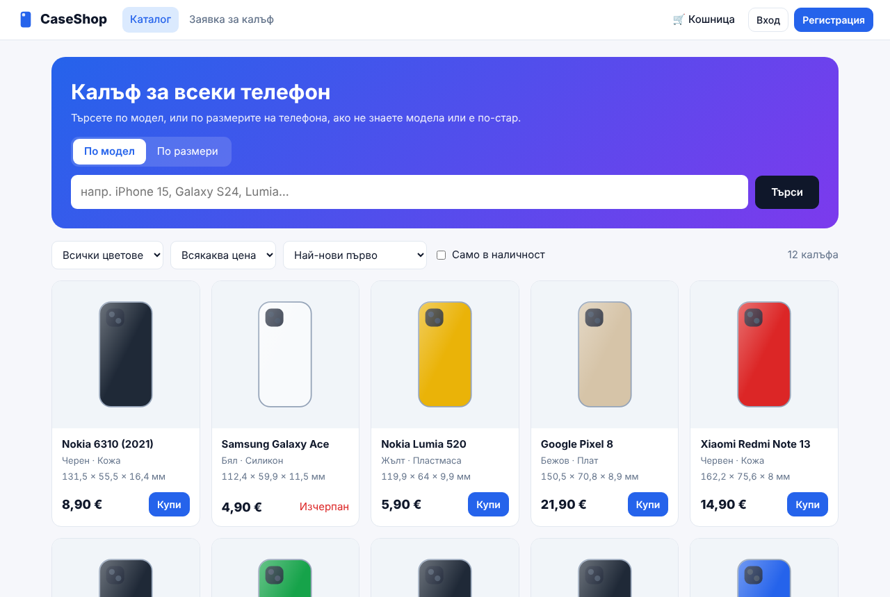
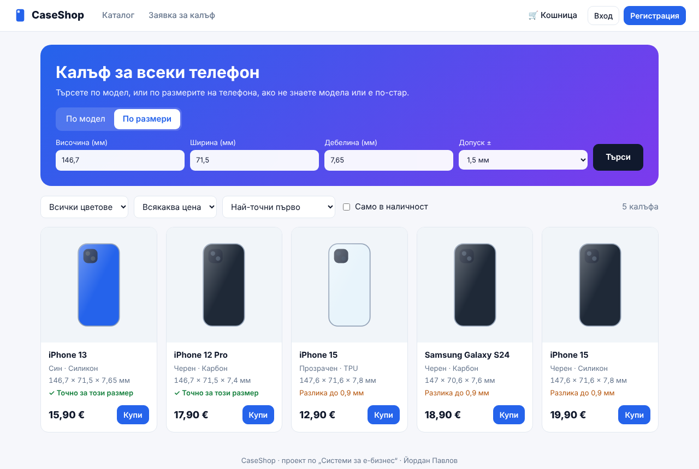
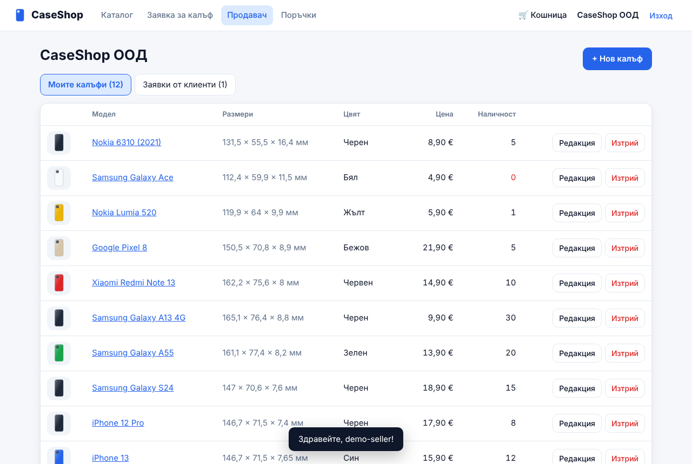
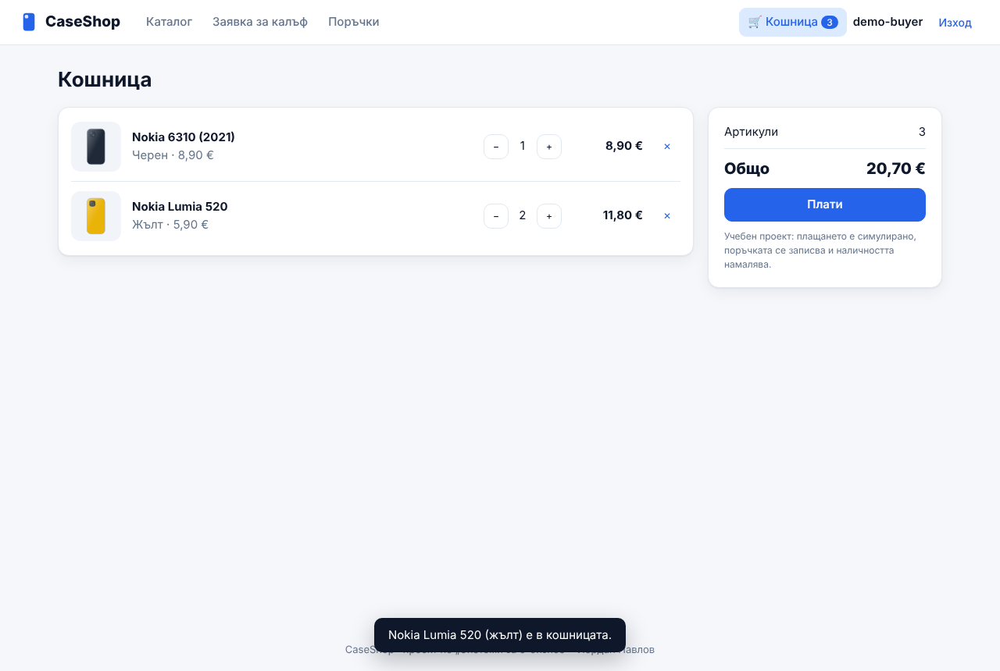
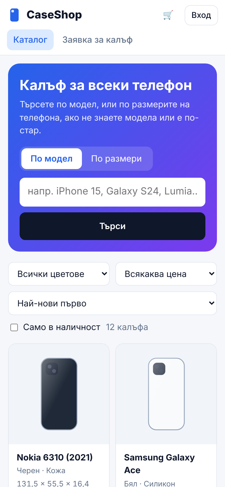
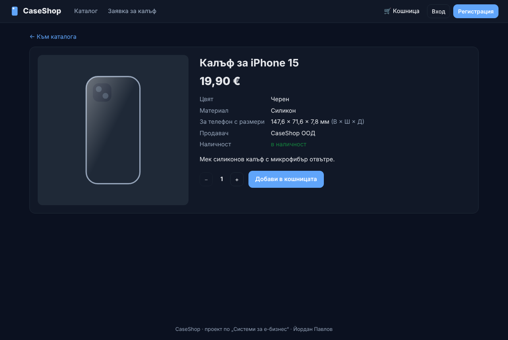

# CaseShop — онлайн магазин за калъфи за телефони

Проект по „Системи за е-бизнес“. Магазин, в който фирми продават калъфи, а клиентите
търсят калъф **по модел** или **по размерите на телефона** — удобно за по-стари
и редки телефони, за които никой не помни модела.

> Оригиналната версия от университета (2023) е запазена в клона
> [`university-2023`](../../tree/university-2023).



## Какво може

**Купувач**
- търсене по модел („iphone 13“, „lumia“ — без значение главни/малки букви и ред на думите);
- търсене по размери (височина × ширина × дебелина) с допуск ±0,5…5 мм; най-точните излизат първи;
- филтри по цвят, цена и наличност; подреждане по цена;
- кошница, която се пази в профила, поръчка и история на поръчките;
- **заявка за калъф**, ако няма подходящ — отива до всички продавачи (и по имейл, ако е настроен SMTP).

**Продавач (фирма)**
- добавя, редактира и трие своите калъфи, със снимка (JPG/PNG/WebP до 3 MB);
- вижда заявките от клиенти и им отговаря с един клик по имейл.

| Търсене по размери | Панел на продавача |
|---|---|
|  |  |

| Кошница | Телефон | Тъмна тема |
|---|---|---|
|  |  |  |

## Стартиране

Нужен е **Node.js 22.22+ или 24+** ([nodejs.org](https://nodejs.org)). Няма нужда от отделна база данни —
всичко се пази във файла `backend/data/shop.db` (SQLite, вграден в Node).

### Бързо (един сървър)

```bash
cd frontend && npm install && npm run build
cd ../backend && npm install && npm start
```

Отворете <http://localhost:5200>.

### За разработка (с презареждане)

```bash
# терминал 1
cd backend && npm install && npm run dev

# терминал 2
cd frontend && npm install && npm start
```

Отворете <http://localhost:4200> — заявките към `/api` се препращат към сървъра на порт 5200.

### С Docker

```bash
docker build -t caseshop .
docker run -p 5200:5200 -v caseshop-data:/data caseshop
```

### Примерни профили

При празна база се добавят 12 примерни калъфа и два профила (парола `demo12345`):

| Потребител | Роля |
|---|---|
| `demo-buyer` | купувач |
| `demo-seller` | продавач (CaseShop ООД) |

Настройки (порт, папка за данните, SMTP за имейлите) — вижте [`backend/.env.example`](backend/.env.example).

## Тестове

```bash
cd backend && npm test
```

Покриват регистрация и вход, права на купувач/продавач, търсене по размери, качване на снимки,
кошница и поръчка (вкл. две поръчки за последния брой), заявки и опити за SQL injection.

## Как е направено

```
backend/     Node.js + Express 5, SQLite (node:sqlite)
  src/app.js         маршрути, сигурност (helmet/CSP), обработка на грешки
  src/db.js          схема на базата
  src/auth.js        сесии в HttpOnly бисквитка, роли, защита от налучкване на пароли
  src/routes/        auth, products, shop (кошница, поръчки, заявки)
  tests/             node:test + supertest
frontend/    Angular 22 (standalone компоненти, signals)
  src/app/core/      услуги към API-то и модели
  src/app/pages/     каталог, калъф, кошница, поръчки, заявка, вход, регистрация, продавач
```

### Какво се промени спрямо версията от 2023

- паролите се пазят хеширани (scrypt), а не в чист вид; вече не минават през адреса на страницата;
- правата (купувач/продавач) се проверяват на сървъра, не само в браузъра;
- всички заявки към базата са с параметри — няма SQL injection;
- търсенето по размери вече не бърка височина и ширина и намира и близки размери;
- базата е локален файл вместо безплатен онлайн MySQL, който може да изчезне;
- имейл паролата вече не е в кода — SMTP се настройва в `.env`;
- кошница с количества и наличност, поръчки, редакция и триене на калъфи, панел със заявките;
- Angular 14 → 22, адаптивен дизайн за телефон и тъмна тема;
- автоматични тестове и GitHub Actions.
